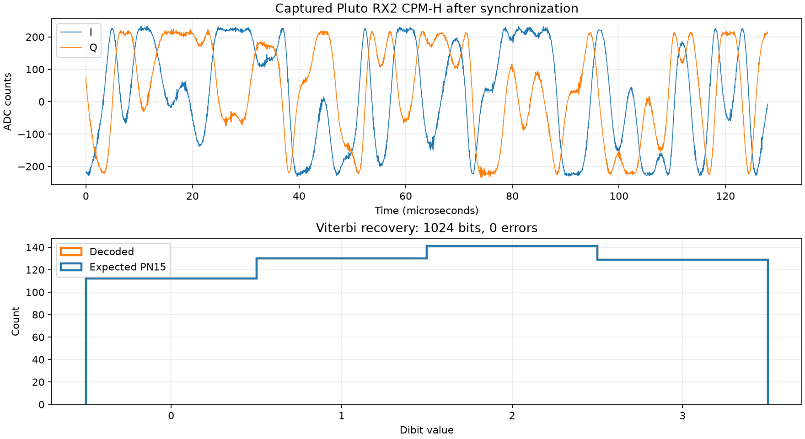

# Pluto loopback CPM-H demodulation result

A Pluto+ transmitted the FPGA-generated deterministic PN15 ARTM CPM-H waveform
from TX1 to RX2 through a 30 dB attenuator. Both converters ran at 16 MS/s,
which gives 32 complex samples per dibit and a 1 Mbit/s information rate. The
RF centre frequency was 915 MHz and the RX/TX RF bandwidth was 4 MHz.

The Python verifier synchronized a stable part of the received stream against
the long known PN15 CPM-H reference. It recovered the absolute symbol number,
initialized the coherent Viterbi detector with the corresponding CPM phase and
two-symbol memory, and compensated the constant carrier phase and gain.

Result:

- synchronization correlation: 0.6810;
- decoded: 512 dibits / 1024 bits;
- bit errors: 0;
- measured BER for this capture: 0.0;
- TX attenuation: -20 dB; external attenuation: 30 dB.

This confirms the complete transmit and offline receive chain for this short
capture. It does not establish a BER curve or sensitivity limit. The raw
interleaved RX2 capture is `rx2-iq.bin`; machine-readable values are in
`result.json`; recovered symbols are in `decoded_dibits.npy`.

