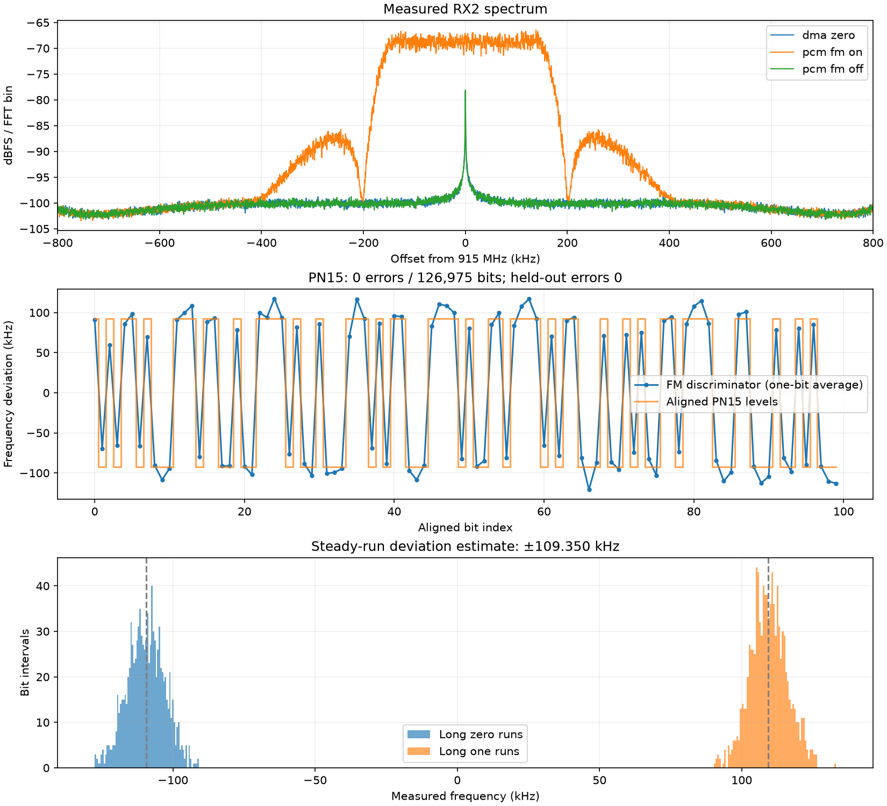

# PCM-FM hardware loopback result

Verified 2026-10-09 on Pluto+ XC7Z010. TX1 -> 30 dB external attenuator -> RX2.
USB networking at 192.168.2.1; no physical Ethernet required.

The custom FPGA generated PN15, Bessel-derived shaping, phase accumulation and
I/Q. A host cyclic DMA buffer contained zeros and enabled the TX path; it did
not supply the modulation samples. GPIO source switching caused the measured
signal to appear/disappear. The FPGA-manager load was volatile, with no flash
or boot-environment changes.

- LO 915 MHz; sample rate 2.5 MS/s; 8 samples/bit; 312.5 kbit/s.
- TX1 gain -40 dB; RX manual gain 30 dB; RF bandwidth 1 MHz.
- RX2 RMS counts: 2.565 (DMA zeros), 20.250 (PCM-FM), 2.579 (source off).
- No clipped samples; RX1 stayed near noise (2.08 RMS counts).
- 126975 recovered PN15 bits: 0 mismatches.
- Alignment trained on 8192 bits; 118783 held-out bits: 0 mismatches.
- Steady-run deviation estimate: +/-109350.5 Hz; target +/-109375 Hz.
- Final state independently read back: selector 0, both TX gains -89.75 dB,
  DDS raw 0, TX buffer disabled, FPGA operating.

## Method and limits

The offline discriminator measures phase change over eight samples. Timing
phase and PN lag are selected on training only; a constant offset and gain are
also fit on training. The held-out section uses those fixed parameters.
Deviation is estimated from medians of runs with seven equal reference bits,
using 1982 bit intervals. The overall fitted decision-level gain (~92.6 kHz)
is smaller than the long-run deviation because pulse shaping smooths transitions.

This is a shared-radio loopback with known bit rate and offline alignment,
not an independent receiver/synchronizer demonstration, BER guarantee or IRIG
RF-mask certification. The deviation estimate is not a calibrated RF instrument
measurement. The spectral plot is an averaged windowed FFT, not the prescribed
spectral-mask procedure.

`results.json` records captures and cleanup; `pcm-fm-analysis.json` records
demodulation; `load-log.txt` and `final-state.txt` record device state.
Raw .bin files remain local and are identified by `capture-sha256.json`.
Loaded payload SHA-256:
`7d4c06da4e1387f05e5d982299e4db2ff012f35cabd4c784a9aedfcd089a6fbd`.

Reanalyse: `python analyze-pcm-fm-hardware.py captures/pcm-fm-hardware-20261009-072118`
from the pluto-dev directory. The loader and capture script are separate actions;
never assume a saved load log alone proves a still-current FPGA configuration.
