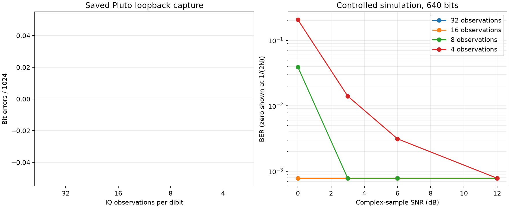

# CPM-H branch-metric observation reduction

This experiment compares 32, 16, 8 and 4 evenly spaced complex-IQ
observations per dibit. Every configuration uses the same fixed-point CPM
Viterbi trellis, integer metrics and traceback.

## Results

The saved 1 Mbit/s Pluto TX1-to-RX2 capture recovered all 1024 checked bits
with every observation count, including four observations per dibit.

A controlled 640-payload-bit simulation included three trailing CPM symbols so
the final payload pulses were fully observed. Results were:

| Complex-sample SNR | 32 obs | 16 obs | 8 obs | 4 obs |
|---:|---:|---:|---:|---:|
| 12 dB | 0 | 0 | 0 | 0 |
| 6 dB  | 0 | 0 | 0 | 2 |
| 3 dB  | 0 | 0 | 0 | 9 |
| 0 dB  | 0 | 0 | 25 | 132 |

Values are bit errors out of 640 bits. This short single-seed experiment selects
an architecture; it is not a calibrated BER curve or sensitivity claim.

## Decision

Use **16 observations per dibit** for the first RTL detector. It halves the
sample-metric work relative to the 32-sample golden reference without changing
a decision in either the real capture or this initial noisy experiment. Keep
32 observations as the verification reference. Reconsider eight observations
only after a longer multi-seed BER sweep.

A literal implementation would still need 16,384 complex sample-distance
operations per dibit. At 100 MHz and 500 kdibit/s, only 200 clocks are
available, implying 82 sample-distance lanes. That is unsuitable for the nearly
full XC7Z010.

The next optimization uses

`|r-s|^2 = |r|^2 + |s|^2 - 2 Re(r conj(s))`.

The received-energy term is common to every branch. CPM templates have constant
ideal energy, leaving a correlation score. Templates also factor into only 64
base `(previous, older, candidate)` waveforms per index parity followed by one
of 32 phase rotations. This structure is the next branch-metric architecture to
prototype before building the parallel add-compare-select array.
