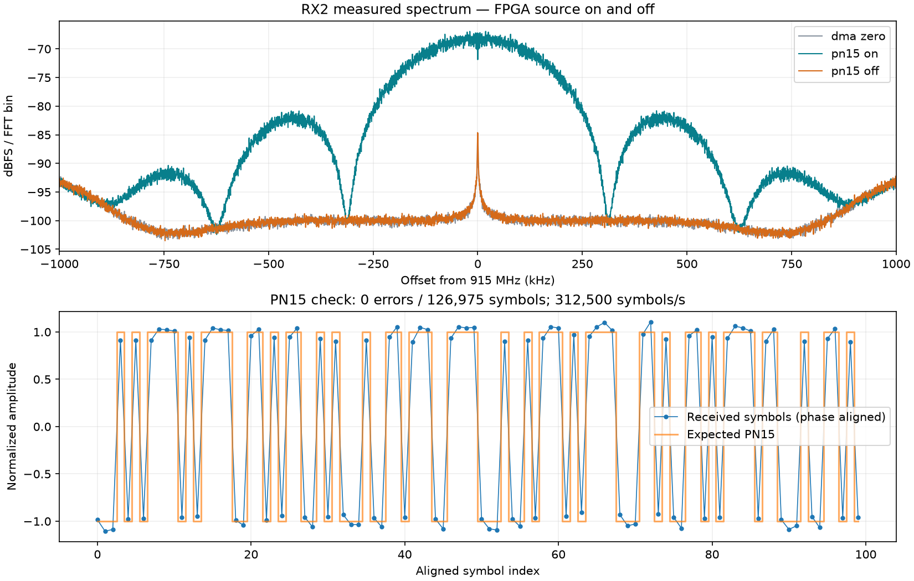

# Pluto+ FPGA transmitter development

## Current status — 2026-10-08

**The custom VHDL PN15/BPSK transmitter has been built, simulated, temporarily
loaded onto the Pluto+, and verified through an RF cable loopback.**

The successful path is FPGA PN15 → BPSK I/Q → ADI TX interpolator → AD9361
TX1 → external 30 dB attenuator → RX2 → host capture and PN15 comparison.
The PC supplied a zero-filled cyclic DMA buffer to enable the existing TX
data path; the PN15 bits and modulation were generated in the FPGA.

- Target: XC7Z010-CLG400, built for speed grade -1 with Vivado 2026.1.
- Modulation: bit 0 gives I=-16384; bit 1 gives I=+16384; Q=0.
- Eight accepted samples per symbol; measured 312500 symbols/s at 2.5 MS/s.
- Hardware test: 126975 symbols checked, zero observed mismatches. Alignment
  used 8192 symbols; 118783 further symbols passed with that alignment fixed.
- No clipping. Source-off captures returned to the noise floor.
- Final readback: PN source select=0, DDS off, both TX gains=-89.75 dB.
- Flash was never written. The custom FPGA configuration is volatile and
  disappears on power-cycle. This status describes the end of the recorded test.

## Verification and progress

| Milestone | Result |
|---|---|
| USB connection | IIO, serial COM3, storage and networking over USB verified |
| Standalone VHDL simulation | PN period, seeds, stalls, restart and sample repetition passed |
| Adapter/wrapper simulation | Request timing, clock-domain control, I/Q gating and DMA bypass passed |
| Vivado migration | Zynq support installed; legacy CDC IP packaging and XSA export repaired |
| Baseline timing | Setup/hold +0.018 ns; no failing endpoints |
| Integrated PN15 timing | Setup +0.854 ns, hold +0.019 ns, pulse width +0.264 ns; zero failing endpoints and DRC errors |
| Stock RF check | RX2 followed 200 kHz and 350 kHz DDS tones; off controls and clipping checks passed |
| Temporary FPGA load | Corrected detached loader completed and restored USB and radio drivers |
| FPGA RF check | PN15 matched at 312.5 ksymbols/s over the confirmed attenuated loopback |

The timing failure was caused by Tcl control flow in an XDC file being skipped
by Vivado. Flat XDC commands now constrain 21 existing target groups; an audit
checks those targets before optimization and after routing. Nine absent groups
from the initial diagnostic were omitted for this fixed hardware configuration.
No blanket false paths or clock-period relaxation were added for that repair.

The first loader attempt lost control when stopping IIO disconnected the shared
USB gadget. Power cycling restored the original firmware. The repaired loader
runs on-device under `nohup setsid`, logs to RAM, unbinds/rebinds USB explicitly,
starts IIO in the background and attempts USB recovery on failure. Its later
successful execution is recorded in [pn15-load-success.txt](pn15-load-success.txt).

## Final FPGA resources

| Resource | Used | Remaining | Total |
|---|---:|---:|---:|
| LUTs | 11262 | 6338 | 17600 |
| Registers | 18836 | 16364 | 35200 |
| BRAM tiles | 2 | 58 | 60 |
| DSP slices | 72 | 8 | 80 |

Compared with the routed baseline, the custom source/control integration added
106 LUTs and 60 registers, with no increase in DSP or BRAM usage.

## Where the work lives

- [tx-starter](tx-starter/README.md): custom VHDL, earlier SystemVerilog version,
  reference-vector generation, testbenches and simulation launchers.
- [plutoplus-vivado2026](plutoplus-vivado2026/README.md): packaging, integration,
  build, timing audit and artifact verification scripts.
- [patches/adi-hdl-plutoplus-vivado2026.patch](patches/adi-hdl-plutoplus-vivado2026.patch):
  complete board/migration changes relative to the pinned ADI HDL base.
- [PLUTO-LOAD-PLAN.md](PLUTO-LOAD-PLAN.md): loading procedure and investigation history.
- [load-pn15-temporary.sh](load-pn15-temporary.sh): device-side temporary loader.
- `stock-loopback.py`, `test-pn15-hardware.py`: bounded hardware tests with cleanup.
- `plot-stock-loopback.py`, `analyze-pn15-hardware.py`: captured-data analysis.
- [Stock test result](captures/stock-loopback-20261008-182356/RESULT.md) and
  [custom FPGA result](captures/pn15-hardware-20261008-183726/RESULT.md): settings,
  measurements, capture formats and limitations.

The local Vivado project is `plutoplus-vivado2026/build/pn15/pluto_pn15.xpr`.
Exported hardware files are under `plutoplus-vivado2026/artifacts/pn15/`.
Reports and SHA-256 manifests are tracked; generated projects, hardware binaries,
large raw captures, downloaded installers and vendor checkouts are kept locally
and excluded from this repository. Result plots and analysis JSON are tracked.

## Reproducing the source/build setup

The vendor checkouts are independent repositories; this repository records their
source revision and patch, rather than embedding their generated trees.

1. Clone `https://github.com/analogdevicesinc/hdl.git` into
   `plutoplus-vivado2026/hdl` and checkout
   `061d024d596ef84c6a819854bf2472e6b43a2d5d`.
2. From that checkout, apply `../../patches/adi-hdl-plutoplus-vivado2026.patch`.
   The equivalent existing local HDL commit is
   `c00f4a550360781013c15b0373709e805946f087`, preserved on branch
   `codex/pluto-vivado2026`.
3. Install Vivado 2026.1 with Zynq-7000 support. From
   `plutoplus-vivado2026`, run `./run-build.ps1 -Stage PackageIp`, then
   `./run-build.ps1 -Stage Baseline`.
4. Run Vivado batch with `integrate-pn15.tcl`, then `build-pn15.tcl`.
   Integration refuses to overwrite an existing PN15 project. `-tclargs
   -reuse-synth` is only for implementation-only retries with unchanged RTL.
5. Convert the exported .bit with Bootgen (`-arch zynq -process_bitstream bin`),
   then run `verify-pn15-artifacts.py`. The processed `.bit.bin` differs in byte
   order and padding from Vivado's raw `.bin`. Neither is a `.frm` updater.

Pluto+ board reference: `https://github.com/plutoplus/plutoplus.git`, pinned at
commit `2d30d36aabc1ba4e7a5982d8548a8e44551218c1`.
See the migration provenance for its original board patch and firmware revision.
Python tests require NumPy; plots also require Matplotlib. Hardware utilities
used libiio 0.26 and PuTTY's plink/pscp on Windows. Existing launchers contain
local installation paths. Hardware scripts pin a device SSH key which changes
after some reboots: reverify it over USB serial before updating the pin.

## Limits and next work

Legacy CDC critical reports (54 CDC-1, 12 CDC-13), scoped-constraint methodology
warnings and missing I/O delays remain. The new source-select crossing is
recognized as a two-stage ASYNC_REG synchronizer. Passing timing and this
loopback does not establish complete CDC correctness or RF conformance.
The physical speed grade was not independently read from the package.

The PN15 comparison used a shared-radio cabled loopback and offline alignment;
it is a finite zero-error observation, not a BER guarantee or an independently
synchronized receiver. No calibrated RF output power was measured.

Next: PCM-FM stimulus shaping plus phase accumulation/IQ generation, simulated
against a reference before integration. SOQPSK and CPM-H remain future work;
no CPM modulator or Viterbi detector has been implemented here.

## PCM-FM reference models

Steps 1 and 2 are now available in [pcm-fm/README.md](pcm-fm/README.md): an executed
explanation notebook, floating-point model, fixed-point model and HDL test vectors.
These are offline models; PCM-FM HDL and Vivado integration are still pending.
